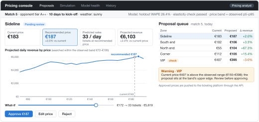
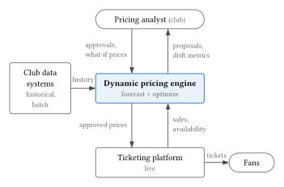
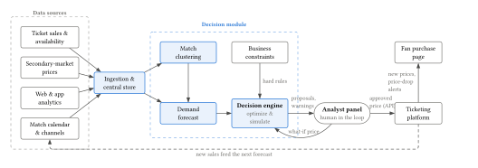
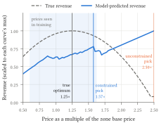
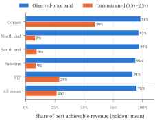
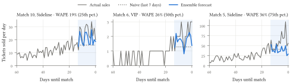
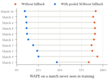

# Dynamic ticket pricing with a human in the loop

<p>
  <a href="./paper/dynamic-pricing.pdf"></a>
  <a href="https://github.com/0trm/dynamic-pricing/actions/workflows/ci.yml"></a>
  
  
  <a href="./LICENSE"></a>
</p>

Forecast ticket demand at every candidate price, pick the revenue-maximizing one, and let a pricing analyst approve it in one click. The engine was deployed at a European football club in 2023; this repository is a reimplementation on synthetic data, written up in the paper [*Human-in-the-Loop Dynamic Pricing for Football Tickets*](./paper/dynamic-pricing.pdf).

| **+6%** | **+4%** | **86%** | **7×** |
| :---: | :---: | :---: | :---: |
| revenue per match | sell-through rate | of proposals approved | faster price updates |

<p align="center">
  
  <br>
  <sub>Analyst control panel (mockup), filled with the model's proposals for one synthetic match ten days before kick-off.</sub>
</p>

## The problem

| Before | After |
| :--- | :--- |
| Prices set once per season in fixed categories (A++, A, B), revised weekly or monthly | A price proposal per match and seating zone, every day |
| Data pulled by hand from several systems | Sales, web analytics and context data in one store |
| No way to test a price before setting it | What-if simulation of revenue and sales at any price |
| Approved prices typed into the ticketing platform | One-click approval pushes the price to the live platform |

## How it works

<p align="center">
  
</p>

1. **Forecast.** One Prophet model per (match, zone) series captures the sales curve over the selling window. One XGBoost model, pooled across series, fits Prophet's residuals from price, demand signals and external factors: `final = max(0, prophet + residual)`. A second XGBoost, trained directly on sales, serves matches with no history yet.
2. **Optimize.** A grid search in €5 steps returns the price with the highest `price × predicted sales`, searching only between the 5th and 95th percentile of prices each zone was actually sold at.
3. **Approve.** The analyst sees the proposal, its revenue curve and a what-if simulator, then approves or rejects it. Approved prices go to the ticketing platform; new sales feed the next forecast.

<details>
<summary>Deployed architecture</summary>
<br>
<p align="center"></p>
</details>

<details>
<summary>Design choices</summary>

| Choice | Why |
| :--- | :--- |
| Prophet + XGBoost on residuals | Prophet handles time to kick-off and weekly patterns; XGBoost learns the non-linear effects of price and context Prophet cannot. |
| Pooled XGBoost fallback | A match that just went on sale has no Prophet model; without the fallback its forecast is the residual alone. |
| Search only observed prices | Trees predict flat sales above the highest training price, so revenue looks unbounded and an unconstrained search picks the cap. |
| Grid search, not Bayesian optimization | Guarantees the best price within the search space, for one prediction batch per match and zone. |
| No `web_conversion_rate` feature | It is `sales / web_visits`, so it leaks the target at decision time and breaks the price response. |

</details>

## Results

### Deployment (2023)

Segment-based A/B tests: a subset of seating zones was priced by the engine, the rest kept the static price list, across matches of varying importance.

| Outcome | Result |
| :--- | :--- |
| Revenue per match (treatment vs. control) | **+6%** |
| Sell-through rate | **+4%** |
| Price update cadence | weekly → daily (**7×**) |
| Proposals approved by analysts | **86%** |

Revenue and sell-through rose together, so the gain came from better prices, not only higher ones. These figures come from confidential club data and cannot be reproduced from this repository.

### Reimplementation on synthetic data

The true demand curve of the synthetic data is known, so every recommendation is scored by the share of the best achievable revenue it earns, not only by forecast error. Holdout: the last 14 days of each series; all models are retrained on the first 77.

| Model | WAPE | R² | MAE | RMSE | MAE vs. naive |
| :--- | ---: | ---: | ---: | ---: | ---: |
| **Ensemble (Prophet + XGBoost)** | 26.4% | **0.729** | 6.2 | **11.7** | 0.71 |
| Prophet only | 41.8% | 0.483 | 9.8 | 16.2 | 1.12 |
| XGBoost only (on sales) | **22.6%** | 0.717 | **5.3** | 12.0 | **0.60** |
| Naive: last 7 days per series | 37.4% | 0.544 | 8.7 | 15.2 | 1.00 |
| Naive: global mean | 79.7% | −0.428 | 18.6 | 27.0 | 2.13 |

<p align="center">
  
  
</p>

- **Recommendations earn 95%** of the best achievable revenue (91% in VIP to 98% in the corners).
- **Searching beyond observed prices drops that to 26%:** no training row is priced above 1.9× base, and 72% of recommendations land at the 2.5× cap.
- The median recommendation is 1.52× base against a true optimum of 1.25×; 19% sit at the band's upper edge.
- **Unseen matches:** the pooled fallback cuts median WAPE from 89.8% to 12.5%, and its recommendations earn 94%.

<details>
<summary>Forecasts and cold start per match</summary>
<br>
<p align="center"></p>
<p align="center"></p>
</details>

`make sanity` fails the model if predicted sales don't move with price or if more than 40% of optimal prices sit at the band's upper edge.

## Quickstart

```bash
pip install -r requirements-dev.txt   # Python 3.12, pinned versions
make all       # synthetic data, train, holdout evaluation, sanity check
make test      # unit tests: optimizer bounds, cold start, save/load
make app       # human-in-the-loop Streamlit page, locally
```

CI runs `make all` and `make test` on every push. To rebuild the paper and its figures, install [Typst](https://typst.app) and run `make figures`.

## Data

`data/03_synthetic/synthetic_match_data.csv` is generated from a fixed seed: 10 matches of varied importance, 91 days of daily sales each, up to 5 seating zones, 37 series and 3,367 zone-days. A single match excitement factor (opponent, league position, injuries, holidays, weekday) drives both demand signals and price levels, and prices also vary with promotions and discounts, so the price effect is identifiable from history. Demand falls linearly with price, so revenue peaks at 1.25× the zone's base price.

<details>
<summary>Feature schema</summary>

| Group | Features |
| :--- | :--- |
| Match | `days_until_match`, `is_weekday`, `opponent_tier`, `ea_opponent_strength`, `is_international` |
| Team status | `team_position`, `top_player_injured`, `league_winner_known` |
| Ticket & zone | `seat_zone`, `ticket_price`, `ticket_availability_pct`, `zone_seats_availability` |
| Demand signals | `internal_search_trends`, `google_trends_index`, `social_media_sentiment`, `web_visits` |
| External | `is_holiday`, `popular_concert_in_city`, `competitor_avg_price`, `flights_to_barcelona_index`, `weather_forecast` |

Target: `zone_historical_sales`, tickets sold per zone and day.

</details>

## Repository

```
├── app.py                    # Streamlit human-in-the-loop page
├── src/
│   ├── data/                 # synthetic data generator (seeded)
│   ├── features/             # feature pipeline
│   ├── models/               # train, predict, evaluate, sanity check
│   └── decision_engine/      # grid-search optimizer and what-if simulation
├── tests/                    # unit tests
├── paper/                    # paper source (Typst), figures script, PDF
└── assets/                   # README figures, exported from the paper
```

## License

[MIT](./LICENSE)
